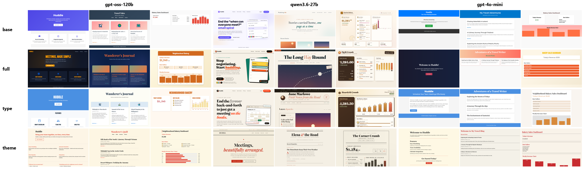

# 01 · Prompt để AI thiết kế web đẹp hơn

**Vì sao web do AI làm trông giống hệt nhau, và một prompt để sửa: thí nghiệm đo trên 36 trang.**

📺 Video (tiếng Việt): https://youtu.be/s3XaTwr0K5U



## Thí nghiệm

- **3 model:** GPT-OSS 120B và Qwen 3.6 27B (qua Groq), GPT-4o mini (OpenAI)
- **3 trang:** landing page ứng dụng hẹn lịch họp, blog du lịch, dashboard tiệm bánh
- **4 system prompt:**
  - `base`: chỉ yêu cầu một file HTML
  - `full`: thêm khối prompt thẩm mỹ
  - `type`: chỉ nói về font chữ
  - `theme`: khoá một chủ đề letterpress
- **Đo bằng trình duyệt** (`shot.py`, Playwright + Chromium headless, 1280×800):
  - font tiêu đề và font thân mà trình duyệt thực sự dùng
  - độ sáng của ảnh chụp
  - tỉ lệ điểm ảnh màu chàm/tím (hue 235–300°)
  - số animation CSS chạy khi tải trang

Temperature 1, mỗi ô một mẫu.

## Kết quả (9 trang mỗi prompt)

| prompt | font thân phổ thông | mảng chàm > 2% | nền tối | có animation | số font tiêu đề khác nhau |
|---|---|---|---|---|---|
| base  | 6/9 | 2/9 | 0/9 | 1/9 | 8 |
| full  | 1/9 | 0/9 | 3/9 | 9/9 | **4** |
| type  | 0/9 | 0/9 | 0/9 | 3/9 | 5 |
| theme | 3/9 | 0/9 | 0/9 | 0/9 | 3 |

- **Prompt đầy đủ** thay đổi rõ font, màu và chuyển động trên cả 3 model.
- **Điểm bất ngờ:** bảo model "hãy khác biệt" thì số font tiêu đề khác nhau lại *giảm* từ 8 xuống 4. Qwen chọn Fraunces cho cả 3 trang, GPT-4o mini chọn Playfair Display cho 2/3 trang. Bỏ được một kiểu mặc định thì lại sinh ra một kiểu mặc định mới.
- **Khoá chủ đề** cho kết quả nhất quán nhất: cả 9 trang đều theo phong cách letterpress màu kem.
- **Bài học về đo lường:** bộ dò màu tím đầu tiên (hue 250–300°) bỏ sót màu chàm `indigo-500` (≈239°). Chỉ nhìn ảnh chụp mới thấy lỗi. Metric cũng là code, phải kiểm tra trên ví dụ nhìn thấy được.

Số liệu đầy đủ ở [`results/results.json`](results/results.json), 36 file HTML và ảnh chụp ở [`results/pages/`](results/pages/).

## Prompt (dán vào system prompt, `AGENTS.md` hoặc `CLAUDE.md`)

```
<frontend_aesthetics>
Left alone, you drift toward the same safe design every time. Make the choices a good human designer would defend.
- Typography: pick distinctive Google Fonts that suit the subject. Pair a characterful display face with a
  readable body face, and use strong contrasts of size and weight.
- Colour and theme: commit to one clear palette, written as CSS variables: a dominant colour and one or two
  sharp accents. Borrow from real sources: magazines, film posters, editor themes, a place or an era.
- Motion: one well-planned entrance with staggered delays, in CSS only, beats many small effects.
- Backgrounds: create depth with layered gradients, patterns or texture instead of one flat colour.
- Avoid: Inter, Roboto, Arial and system fonts; purple gradients on white; the same centred hero with three
  cards every time.
Make every design different: light or dark, different fonts, different layout.
</frontend_aesthetics>
```

**Mẹo tránh "mặc định mới":** đổi nguồn cảm hứng cho mỗi lần tạo (ví dụ "poster phim noir thập niên 40", "tạp chí Thuỵ Sĩ"), hoặc cho người dùng chọn chủ đề.

## Tự chạy

```bash
pip install -r requirements.txt
python -m playwright install chromium

# tạo file .env cạnh experiment.py:
#   GROQ_API_KEY=...     (miễn phí tại console.groq.com)
#   OPENAI_API_KEY=...   (chỉ cần cho gpt-4o-mini)

python experiment.py --measure-only   # đo lại 36 trang có sẵn, không gọi API
python experiment.py --models gpt-oss-120b --tasks saas   # chạy thử nhỏ
```

Muốn sinh lại một trang thì xoá file `.html` của trang đó trong `results/pages/`. Câu trả lời của model được cache trong `results/cache/`, chạy lại không tốn tiền.

## Giới hạn

- Mỗi ô chỉ một mẫu, ở temperature 1: hãy tin xu hướng trên 9 trang, không tin một trang lẻ.
- Metric thấy font, màu và chuyển động. Nó không thấy cái đẹp hay tính dễ dùng, nên luôn phải xem ảnh chụp.
- Thí nghiệm không dùng model Claude.

## Nguồn

Ý tưởng từ Anthropic **Claude Cookbooks** (giấy phép MIT), notebook
[`coding/prompting_for_frontend_aesthetics.ipynb`](https://github.com/anthropics/claude-cookbooks/blob/main/coding/prompting_for_frontend_aesthetics.ipynb).
Thí nghiệm, các prompt, code và số liệu ở đây do mình tự viết và tự chạy.

---

*English summary: 36 AI-generated pages (3 models × 3 pages × 4 system prompts), rendered headless and measured.
An aesthetics prompt removes generic fonts and adds motion, but cuts distinct heading fonts from 8 to 4: the
models find a new default. A fixed theme is the most consistent. Code is MIT-licensed.*
